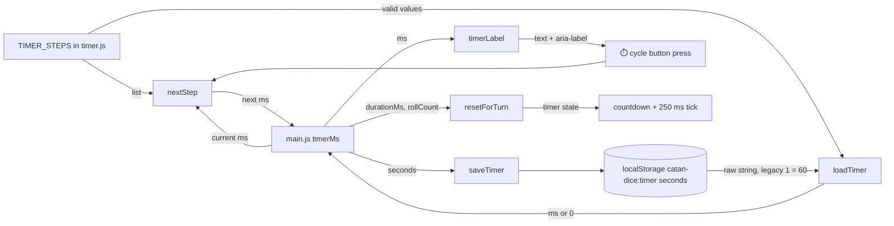

# ADR: Pure injected-clock turn timer with a configurable duration cycle, driven by a 250 ms interval in main.js
- Status: Accepted
- Date: 2026-11-15
- Spec: specs/turn-timer.md
- Supersedes: none

> The original on/off timer was built before ADRs were required (commits 703ce1b, f9fcea7, 1b746d3, 78758d5 on `feat/turn-timer`, PR #4), so that part of this record is retrospective. The spec amendment in 4d1e62f replaces the on/off toggle with a duration cycle (off → 1 → 2 → 3 min → off). That change is planned work: tasks T5 to T7 below. This ADR is edited in place to cover both.

## Context
The spec adds an optional per-turn countdown to the game screen. It pulses in the last 10 s and shouts "TICK TOCK, <name>!" once at 0 through the existing banner, `playShout()` and `HAPTIC_PATTERNS.shout`. The amendment turns the ⏱️ on/off toggle into a single cycle button. The button steps through a maintainer-edited list (`TIMER_STEPS`, default off → 60 → 120 → 180 s → off), shows the selected duration, and persists it under the existing `catan-dice:timer` key, now as seconds. A legacy `"1"` (the old "on") has to keep working as 1 minute. The project rules require logic to be testable with `node --test`: no dependencies, no DOM tests, no real clocks. So the step cycle, its labels, the storage validation and the duration-aware reset all have to live in pure modules. The codebase already splits pure modules (`game.js`, `events.js`, `shake.js`, `haptics.js`, `timer.js`) from one wiring file (`main.js`), and all storage access goes through the guarded `ui/storage.js` wrapper. The non-functional needs are a low runtime cost (no work while idle or hidden), no catch-up nag burst after backgrounding, and no layout shift on a 360×640 phone, including when the button label changes.

## Decision
We keep all timer state transitions and derived values in the pure module `js/timer.js`. Its state is an immutable plain object `{ status: idle|running|paused, durationMs, warnMs, startedAt, elapsedMs, nagged }`, and every function takes `now` as an argument. "Expired" is derived by `timerPhase` (remaining = 0 while running), and `nagged` is a one-shot latch that `tickTimer` sets. `warnMs` stays 10 000 for every duration, so the existing `remaining <= warnMs` rule already gives AC-21.

For the cycle, we add three pure pieces to `timer.js`, and `main.js` and `storage.js` use them, so the list lives in exactly one place (AC-18):
- `TIMER_STEPS = Object.freeze([60000, 120000, 180000])`: durations in ms, in cycle order. Off is implicit (`0`): it is never listed, it always comes first, and the cycle wraps back to it after the last entry. A maintainer therefore cannot accidentally remove off or put it in the middle of the cycle.
- `nextStep(currentMs, steps = TIMER_STEPS)`: `0` → `steps[0]`; `steps[i]` → `steps[i+1]`, or `0` after the last; any value not in the list → `0`. The `steps` parameter lets tests drive AC-18 with arbitrary lists.
- `timerLabel(ms)` → `{ text, aria }`: `⏱️ Off` / `Turn timer: off`, `⏱️ N min` / `Turn timer: N minute(s)`, with a `⏱️ N s` / `Turn timer: N second(s)` fallback for steps that are not whole minutes. AC-19's wording therefore follows any list and is unit-tested.

`resetForTurn(t, { durationMs, rollCount }, now)` replaces the `enabled` flag with the duration. If `durationMs` is a finite number > 0 and `rollCount >= 1`, it returns `startTurn({ ...t, durationMs }, now)`; otherwise it returns `stopTimer(t)`. A non-finite `now` is checked first and returns `t` unchanged (AC-8). This stays the single reset rule. A mid-turn press (AC-20) is just another `resetForTurn` with the new duration, which restarts from full and clears `nagged`.

Storage keeps the key `catan-dice:timer` and stores whole seconds. `saveTimer(ms)` writes `String(Math.round(ms / 1000))`, and off or an invalid value is written as `"0"`. `loadTimer(steps = TIMER_STEPS)` uses a strict digits-only parse and maps `"1"` to 60. It returns the value in ms only if that value is in `steps`, and `0` otherwise. That rule covers absent, empty, `"0"`, `"abc"`, `"-5"`, `"1.5"`, `"90"`, `"2"` and a removed step. Migration is read-only: the legacy `"1"` is never rewritten on load, and the next press saves seconds.

`main.js` holds `timer` and `timerMs` (the selected duration, `0` = off) plus one `setInterval(tick, 250)`. `syncTimer()` keeps the interval alive only while the timer is `running` and has not nagged. `main.js` feeds the timer `performance.now()`, and it maps lifecycle events to the pure transitions:
- `rollWith` → `stopTurnTimer` (the timer is idle while the dice tumble)
- `reveal`, `updateGame` (Undo, ◀/▶), `cycleTimer` and page load → `resetTurnTimer`, which passes `{ durationMs: timerMs, rollCount }` and pauses at once if the page is hidden. During a tumble it keeps the timer stopped, so `reveal` picks up whatever duration is selected by then (AC-20).
- `newGame` → `stopTurnTimer`
- `visibilitychange` hidden and `pagehide` → `pauseTurnTimer`
- `visibilitychange` visible and `pageshow` with `persisted` → `resumeTurnTimer`

The ⏱️ button becomes a cycle button (`.btn--cycle`, no `aria-pressed`). It has a fixed flex basis sized for `⏱️ 3 min`, a height of `var(--tap)` and `white-space: nowrap`. `renderToggles` writes `textContent` and `aria-label` from `timerLabel(timerMs)`, on load and after every press. The countdown is a non-live `
` that always takes up its space: when idle it is `visibility: hidden` with a reserved `min-height`. The phase classes are `.timer--warning` (pulsing unless the user prefers reduced motion) and `.timer--expired`.

| File / module | Change | ACs |
|---|---|---|
| `js/timer.js` | Pure module (done in T1/R1). T5: add `TIMER_STEPS`, `nextStep`, `timerLabel`; `resetForTurn` takes `{ durationMs, rollCount }` and adopts the duration; checks non-finite `now` before applying the duration | AC-1..AC-8, AC-17, AC-18, AC-19 (labels), AC-20 (reset rule), AC-21 |
| `test/timer.test.js` | T5: AC-5/AC-8 cases move from `enabled` to `durationMs`; new AC-2/AC-21 cases for 120 s, 180 s and a 5 s step; AC-6 `120000`/`180000`; AC-17, AC-18 (custom list, wrap, invalid current); AC-19 `timerLabel`; AC-20 mid-turn/expired reset to a new duration | AC-1..AC-8, AC-17..AC-21 |
| `js/ui/storage.js` | T6: import `TIMER_STEPS`; `loadTimer(steps = TIMER_STEPS)` returns ms, `saveTimer(ms)` writes seconds, legacy `"1"` → 60 s if listed | AC-9, AC-18 |
| `test/turn-timer-storage.test.js` | T6: rewrite the AC-9 cases (absent/`""`/`"0"`, each step, legacy `"1"`, `"abc"`/`"-5"`/`"90"`/`"2"`/`"1.5"`, round-trip, throwing storage); AC-18 case with a custom list | AC-9, AC-18 |
| `js/main.js` | T5: a one-line adapter in `resetTurnTimer`. T6: `timerOn` → `timerMs`; `toggleTimer` → `cycleTimer` (`nextStep`, `saveTimer`, `resetTurnTimer`). T7: `renderToggles` renders `timerLabel`, no `aria-pressed` on the timer button | AC-11, AC-15, AC-16, AC-19, AC-20 |
| `index.html` | T7: `#timer-toggle` gets class `btn--cycle`, no `aria-pressed`, initial `⏱️ Off` / `aria-label="Turn timer: off"` | AC-10, AC-19 |
| `css/styles.css` | T7: `.row .btn--cycle` (fixed flex basis for the longest label, `min-height: var(--tap)`, `nowrap`, smaller font, no letter-spacing/uppercase shift); `.timer*` rules unchanged | AC-10, AC-12 |
| `README.md` | T7: Usage describes the cycle and the `catan-dice:timer` key in seconds | (docs) |

## Alternatives considered
- **A separate on/off toggle plus a duration picker (a `<select>` or a second button)**: rejected. It means two controls where the spec asks for one, and it does not fit the 360 px controls row next to New game and two 48 px toggles. It also creates redundant states ("on" with no duration, or a duration while off) that would need extra rules and tests.
- **A settings screen or dialog for the duration**: rejected. A settings UI is out of scope in the spec, it adds a screen, focus handling and extra taps at the table, and a one-button cycle through three steps is faster.
- **Store the step index instead of seconds**: rejected. An index changes meaning when a maintainer inserts or reorders a step (index 1 would silently become a different duration), so AC-18's "removed step loads as off" is impossible to tell apart. It also collides with the legacy `"1"`. Seconds are self-describing, and validation is simply "is it in the list".
- **Store ms, or move to a new key with a one-time migration write**: rejected. The spec fixes seconds under the same key. A new key would need a migration write plus cleanup of the old key, while the in-place read is already unambiguous (`"1"` can never be a real 1 s step).
- **Keep `enabled` in `resetForTurn` and add `durationMs` next to it**: rejected. Two inputs encode one fact, and `enabled: true, durationMs: 0` would need its own rule. "Off" is simply `durationMs: 0`.
- **List off explicitly as `0` in `TIMER_STEPS`**: rejected. A maintainer could drop it or place it mid-list, which breaks AC-17/AC-18 ("wraps back to off"). An implicit off makes that impossible.
- **Retained from the original decision**: no timer state in `game.js`/`serialize`, no persisted remaining time, no `requestAnimationFrame` loop, no self-clocking timer class, and no background catch-up. Every one of these is still rejected for the reasons in the spec (out of scope, wall-clock jumps, 15× more wake-ups, untestable without fake timers, and the pause-while-hidden decision).

## Consequences
- Positive: the whole cycle (order, wrap, invalid current value, labels, storage validation, legacy mapping, duration-aware reset, the warning window at every duration) is covered by deterministic unit tests. Editing `TIMER_STEPS` alone changes the cycle, the labels and the valid saved values.
- Positive: the wiring change in `main.js` is small. `timerOn` becomes `timerMs`, and the press handler does `nextStep` → `saveTimer` → `resetTurnTimer`. The reset rule and the interval guard stay single functions.
- Negative / trade-offs: AC-10..AC-16, AC-19 and AC-20 remain **manual QA** for the DOM side. The tests cover the label strings and the reset rule, but not that `main.js` actually renders and calls them.
- Negative / trade-offs: the timer button gets wider (a text label instead of a 48 px icon), so the **360×640 fit of the controls row is a fresh risk** on top of the original unverified fit.
- Negative / trade-offs: a legacy `"1"` stays in storage until the next press. This is harmless, because every load maps it again.
- Cost & performance: nothing changes at runtime. Ticks happen only while running (4/s, a few arithmetic operations and DOM writes), with one localStorage write per press. There is no network and no paid service. `nextStep` and `loadTimer` are O(list length), on a 3-entry list.
- Risks: a maintainer adds a step that is not a whole second (for example 1500 ms) → `saveTimer` rounds it, so it no longer matches on load and reloads as off. Mitigation: a comment on `TIMER_STEPS` says "positive whole seconds, in ms", and the behaviour fails safe (off).
- Risks: the controls row overflows at 360 px → New game shrinks first (`flex: 1; min-width: 0`), then the visible label shortens to `⏱️ 3m` per the spec's open question. The 48 px tap targets stay. A manual check at 360×640 is part of T7.
- Risks: a maintainer adds a longer label (for example `⏱️ 10 min`) → the fixed width clips it. The CSS comment names the label that the width is sized for, and AC-10 manual QA catches it.
- Risks (unchanged): if the page is hidden in the ≤250 ms window after 0, one nag fires on return (once, because of the latch). On iOS the shout can be dropped after a lock, and the banner still shows. A `confirm()` dialog can delay a nag until it closes. The spec accepts all of these.

## Diagram
`status` is stored (idle / running / paused). `Counting`, `Warning` and `Expired` are phases that `timerPhase` derives while running. `Nagged` is the `nagged` latch. "dur" is the selected `timerMs`.

```mermaid
stateDiagram-v2
  [*] --> idle : createTimer()
  idle --> running : resetForTurn(dur>0, rolls>=1) [reveal, Undo, prev/next, cycle press, load]
  running --> running : resetForTurn(dur>0, rolls>=1) [restart from full dur, nagged=false]
  running --> paused : pauseTimer [hidden / pagehide]
  paused --> running : resumeTimer [visible / pageshow persisted]
  running --> idle : stopTimer / resetForTurn(dur=0 or 0 rolls) [roll starts, New game, cycle to off]
  paused --> idle : stopTimer / resetForTurn(dur=0 or 0 rolls)
  state running {
    [*] --> Counting
    Counting --> Warning : remaining <= 10 s (any dur)
    Warning --> Expired : remaining = 0
    Counting --> Expired : time jump to 0
    Expired --> Nagged : tickTimer nag=true (banner, shout, vibrate; interval cleared)
  }
```

How the selected duration flows through press and load (`TIMER_STEPS` is the only list):

## Spec changes
- AC-8: "A non-finite `now` returns the state unchanged (and `tickTimer` returns `nag: false`)." → "A non-finite `now` makes the time-dependent transitions (`startTurn`, `pauseTimer`, `resumeTimer`, `tickTimer`, and the start branch of `resetForTurn`) return the state unchanged (and `tickTimer` returns `nag: false`); `stopTimer` and the idle branch of `resetForTurn` do not use `now` and still return an idle timer." — Read literally, the old wording clashed with AC-5 for `resetForTurn` with the timer off and `now` = NaN: AC-5 requires an idle timer, while AC-8 required the state unchanged. This is a clarification only, and nothing visible to the user changes.
- AC-9: "the legacy toggle value `"1"` (old "on") → 60 000 ms (1 minute);" → "… → 60 000 ms (1 minute), as long as 60 s is a step in the list (otherwise off, like any other value not in the list);" — Without this, AC-9 (legacy → 60 s) and AC-18/the open question (any saved value not in the list loads as off) conflict if a maintainer removes the 60 s step. With the default list nothing changes, so the user-visible intent is the same. The matching open-question line was updated too.
- Technical notes: rewritten for the duration cycle (`TIMER_STEPS` with implicit off, `nextStep`, `timerLabel`, `resetForTurn({ durationMs, rollCount })`, `loadTimer`/`saveTimer` in seconds with read-only legacy migration, `cycleTimer`, `.btn--cycle` without `aria-pressed`, test file coverage). The "these notes predate the amendment, the ACs win" preamble was removed because the notes no longer contradict the ACs. No AC was changed by this.

## Implementation plan
T1–T3 and R1 are done on `feat/turn-timer`. T5–T7 implement the duration-cycle amendment, in dependency order. Each task leaves `npm test` and `npm run lint` green, and leaves the app working.

1. T1 Pure turn timer module (done, 703ce1b) — files: `js/timer.js`, `test/timer.test.js` — ACs: AC-1..AC-8 — size M
2. T2 Persist turn timer setting (done, f9fcea7) — files: `js/ui/storage.js`, `test/turn-timer-storage.test.js` — ACs: AC-9 (on/off version) — size S
3. T3 Turn timer UI, toggle, pulse and nag (done, 1b746d3) — files: `js/main.js`, `index.html`, `css/styles.css`, `README.md` — ACs: AC-10..AC-16 (on/off version, manual QA) — size M
4. R1 Review fixes (done, 78758d5) — files: `js/main.js` (resume on bfcache `pageshow`), `js/timer.js` (`createTimer(null)` safe), `test/timer.test.js` (paused-reset AC-5 case, `createTimer(null)` AC-8 case) — ACs: AC-14, AC-5, AC-8 — size S
5. T5 Pure duration steps and duration-aware reset — files: `js/timer.js` (add `TIMER_STEPS`, `nextStep(currentMs, steps = TIMER_STEPS)`, `timerLabel(ms)`; change `resetForTurn` to `{ durationMs, rollCount }`, adopting `durationMs` and checking non-finite `now` first), `js/main.js` (one-line adapter only: `resetForTurn(timer, { durationMs: timerOn ? TIMER_DEFAULTS.durationMs : 0, rollCount: game.rolls.length }, now)`), `test/timer.test.js` (update the AC-5/AC-8 cases to `durationMs`, including `0`/`null`/`NaN`/`-1`/`"60000"` → idle, and NaN `now` → same object; add `AC-2: phase boundaries hold for 120 s and 180 s`, `AC-21: warning is the final 10 s for every duration; a 5 s step starts in warning`, AC-6 `120000 → "2:00"`/`180000 → "3:00"`, `AC-17: default cycle off → 60 → 120 → 180 → off`, `AC-18: custom list order and wrap; unknown/null/NaN/negative/legacy current → off; empty list → off`, `AC-19: timerLabel text and aria for off, 1/2/3 min, and a non-minute step`, `AC-20: resetForTurn with a new duration restarts a running/expired+nagged timer at full new duration, nagged cleared`) — ACs: AC-2, AC-5, AC-6, AC-8, AC-17, AC-18, AC-19 (labels), AC-20 (reset rule), AC-21 — size M
6. T6 Store the duration in seconds with legacy migration, and wire the cycle — files: `js/ui/storage.js` (import `TIMER_STEPS`; `loadTimer(steps = TIMER_STEPS)` → ms or 0, using a digits-only parse with `"1"` → 60 and then a list check; `saveTimer(ms)` → whole seconds, `"0"` for off/invalid), `js/main.js` (`timerOn` → `timerMs = store.loadTimer()`; `toggleTimer` → `cycleTimer`: `timerMs = nextStep(timerMs)`, `store.saveTimer(timerMs)`, `resetTurnTimer()`, `renderToggles()`; `resetTurnTimer` passes `durationMs: timerMs`; interim `aria-pressed` = `String(timerMs > 0)` until T7), `test/turn-timer-storage.test.js` (replace the boolean cases: `AC-9: absent, "" and "0" load as off`, `AC-9: "60"/"120"/"180" load as ms`, `AC-9: legacy "1" loads as 60000`, `AC-9: "abc", "-5", "1.5", "90", "2" load as off`, `AC-9: saveTimer writes seconds and round-trips every step`, `AC-9: throwing localStorage → off, save is a no-op`, `AC-18: loadTimer follows a custom list (removed step → off; legacy "1" → off when 60 s is not listed)`) — ACs: AC-9, AC-18, AC-11, AC-15, AC-16, AC-20 (wiring, manual QA) — size S
7. T7 Cycle button presentation — files: `index.html` (`#timer-toggle`: `btn--cycle` instead of `btn--toggle`, remove `aria-pressed`, initial `⏱️ Off`, `aria-label="Turn timer: off"`), `js/main.js` (`renderToggles` sets `el.timerToggle.textContent`/`aria-label` from `timerLabel(timerMs)` and drops the interim `aria-pressed`), `css/styles.css` (`.row .btn--cycle`: fixed `flex-basis` for `⏱️ 3 min`, `min-height: var(--tap)`, `white-space: nowrap`, `padding: 0 6px`, a smaller font with no letter-spacing; a comment naming the label the width is sized for; New game shrinks first if needed), `README.md` (Usage: cycle off → 1 → 2 → 3 min, `catan-dice:timer` in seconds). No test file changes: the label strings are already covered by the AC-19 test in T5. Finish with a manual check at 360×640 — ACs: AC-10, AC-19, AC-12 (layout unaffected) — size M

Outstanding (not a coder task): after T7, a manual QA pass of AC-10..AC-16, AC-19 and AC-20 on a 360×640 viewport, with and without `prefers-reduced-motion`. It must include: the legacy `"1"` reloading as `⏱️ 1 min`, a press mid-countdown restarting at the new duration, a press during the tumble, and a press before the first roll.
