# ADR: Pure injected-clock turn timer, driven by a 250 ms interval in main.js
- Status: Accepted
- Date: 2026-11-15
- Spec: specs/turn-timer.md
- Supersedes: none

> Retrospective ADR. The feature was built before ADRs were required (commits 703ce1b, f9fcea7, 1b746d3, 78758d5 on `feat/turn-timer`, PR #4). This record describes the architecture as built.

## Context
The spec adds an optional 60 s per-turn countdown to the game screen. It pulses in the last 10 s and shouts "TICK TOCK, <name>!" once at 0 through the existing banner, `playShout()` and `HAPTIC_PATTERNS.shout`. The project rules require logic to be testable with `node --test`: no dependencies, no DOM tests, no real clocks. So every timer decision has to sit outside the DOM wiring, and time has to be passed in. The codebase already splits pure modules (`game.js`, `events.js`, `shake.js`, `haptics.js`) from one wiring file (`main.js`), and every setting is stored as `"1"`/`"0"` through the guarded `ui/storage.js` wrapper. The non-functional needs are a low runtime cost (no work while idle or hidden), no catch-up nag burst after the page is backgrounded, and no layout shift on a 360×640 phone.

## Decision
We keep all timer state transitions and derived values in a new pure module, `js/timer.js`. Its state is an immutable plain object `{ status: idle|running|paused, durationMs, warnMs, startedAt, elapsedMs, nagged }`. Every function takes `now` as an argument, so the module never reads a clock. "Expired" is not a stored status: `timerPhase` derives it as remaining = 0 while running. `nagged` is a one-shot latch that `tickTimer` sets the first time remaining reaches 0, so a single large time jump still nags only once. `resetForTurn(t, { enabled, rollCount }, now)` is the single reset rule. `main.js` holds one `timer` value plus one `setInterval(tick, 250)`. `syncTimer()` keeps the interval alive only while `status === "running" && !nagged`. `main.js` feeds it `performance.now()`, and it maps lifecycle events to the pure transitions:
- `rollWith` → `stopTurnTimer` (the timer is idle while the dice tumble)
- `reveal`, `updateGame` (Undo, ◀/▶), `toggleTimer` and page load → `resetTurnTimer` (which also pauses at once if the page is hidden)
- `newGame` → `stopTurnTimer`
- `visibilitychange` hidden and `pagehide` → `pauseTurnTimer`
- `visibilitychange` visible and `pageshow` with `persisted` → `resumeTurnTimer`

The on/off setting is the only thing persisted, as `catan-dice:timer` through `loadTimer`/`saveTimer` in `ui/storage.js`. The countdown is a non-live `
` that always takes up its space: when idle it is `visibility: hidden` with a reserved `min-height`. Phase classes are `.timer--warning`, which pulses unless the user prefers reduced motion, and `.timer--expired`.

| File / module | Change | ACs |
|---|---|---|
| `js/timer.js` | New pure module: `TIMER_DEFAULTS`, `createTimer`, `startTurn`, `stopTimer`, `pauseTimer`, `resumeTimer`, `remainingMs`, `timerPhase`, `tickTimer`, `resetForTurn`, `formatRemaining`, `nagText` | AC-1..AC-8 |
| `test/timer.test.js` | New: `describe("turn-timer")`, cases titled AC-1..AC-8 | AC-1..AC-8 |
| `js/ui/storage.js` | Add `KEYS.timer = "catan-dice:timer"`, `loadTimer`, `saveTimer` (same pattern as shake) | AC-9 |
| `test/turn-timer-storage.test.js` | New: stub/throwing `localStorage` cases titled AC-9 | AC-9 |
| `js/main.js` | Timer state and 250 ms interval; `renderTimer`, `nag`, `tick`, `syncTimer`, `stopTurnTimer`, `resetTurnTimer`, `pauseTurnTimer`, `resumeTurnTimer`, `toggleTimer`; hooks in `rollWith`, `reveal`, `updateGame`, `newGame`, visibility/pagehide/pageshow, load; toggle `aria-pressed` in `renderToggles` | AC-10, AC-11, AC-13..AC-16 |
| `index.html` | `#timer` countdown under `#next-up` (not `aria-live`); `#timer-toggle` ⏱️ button after `#shake` | AC-10, AC-11 |
| `css/styles.css` | `.timer` (reserved height, tabular numbers), `.timer--idle` (`visibility: hidden`), `.timer--warning` + `@keyframes timerpulse` (turned off under reduced motion), `.timer--expired`, light-scheme colours | AC-10, AC-12, AC-13 |
| `README.md` | Usage: third toggle and the `catan-dice:timer` key | (docs) |

## Alternatives considered
- **Store timer state in `game.js` / `serialize` (persist it with the game)**: rejected. The spec puts changes to game state out of scope. The timer would get mixed into undo/re-roll history and the saved-game format. And because `performance.now()` restarts on every page load, a saved `startedAt` means nothing after a reload.
- **Persist the remaining time across reloads (for example `Date.now()`-based `startedAt` in localStorage)**: rejected as out of scope (spec: "Only the on/off setting is saved"). It would need a wall clock, which can jump, instead of the monotonic clock. And it buys nothing for the main reload path: Start game reloads into a zero-roll game, which shows no countdown anyway.
- **`requestAnimationFrame` loop instead of a 250 ms `setInterval`**: rejected. rAF runs at about 60 Hz to redraw an `m:ss` label that changes once a second, which is roughly 15× more wake-ups for no visible gain. With rAF, "alive only while running" would mean re-scheduling every frame rather than one create/clear in `syncTimer`. 250 ms keeps the nag within a quarter-second of 0:00 and the rounded-up seconds accurate. Hidden-tab throttling does not matter, because the timer is paused while hidden.
- **Timer object with an internal clock or interval (a class that calls `Date.now`/`setInterval` itself)**: rejected. It cannot be tested with `node --test` without fake timers, and the spec requires a pure module with time injected.
- **Keep counting in the background and catch up on return**: rejected by the spec's decisions (pause while hidden, no background nag, no burst on return).

## Consequences
- Positive: all branching logic (clamping, the warning boundary, the once-only nag, pause arithmetic, bad `now` values, the reset rule) is covered by fast, deterministic unit tests. `main.js` only translates events into calls. There are no new dependencies, sounds or haptic patterns.
- Positive: there is one reset rule (`resetForTurn`) and one interval guard (`syncTimer`), so the "when does it run" logic lives in two small functions instead of being spread across the handlers.
- Negative / trade-offs: AC-10..AC-16 (toggle, countdown display, resets, pulse, nag, hide/show, reload, toggle off/on) are **manual QA only**. No automated test exercises the `main.js` wiring, so a broken hook (for example a missing `resetTurnTimer` call) would only show up by hand.
- Negative / trade-offs: the **360×640 fit is unverified**. The new countdown line (1.2em plus a column gap) adds height to the game screen, and the toggles row now holds New game plus three 48 px toggles. AC-10 requires everything to stay visible without scrolling, with no horizontal scroll, and nobody has checked that at 360×640 yet.
- Cost & performance: nothing runs while the timer is idle, paused, hidden or already nagged, because `syncTimer` clears the interval. While running, the cost is 4 ticks per second, each a few arithmetic operations plus a `textContent` write and three `classList.toggle` calls. There is one localStorage write per toggle tap, and no network or paid services.
- Risks: the page is hidden during the ≤250 ms window after remaining reaches 0 and before the next tick → on return, the next tick fires one nag (once, not a burst, thanks to the `nagged` latch). This is acceptable under AC-14.
- Risks: a nag is not a user gesture, so on iOS the shout sound can be dropped after the phone was locked → the banner still shows. The spec accepts this (edge case).
- Risks: on a fast device a `confirm()` dialog for New game blocks the interval → the next tick evaluates normally after the dialog closes, which may nag at once. The spec accepts this.
- Risks: a regression in the manual-QA wiring → the PR checklist must include a manual pass of AC-10..AC-16 at 360×640, with and without reduced motion.

## Diagram
`status` is stored (idle / running / paused). `Counting`, `Warning` and `Expired` are phases that `timerPhase` derives while running. `Nagged` is the `nagged` latch, set by `tickTimer`.

```mermaid
stateDiagram-v2
  [*] --> idle : createTimer()
  idle --> running : resetForTurn(on and rolls>=1) [reveal, Undo, prev/next, toggle on, load]
  running --> running : resetForTurn(on and rolls>=1) [restart from 1:00, nagged=false]
  running --> paused : pauseTimer [hidden / pagehide]
  paused --> running : resumeTimer [visible / pageshow persisted]
  running --> idle : stopTimer / resetForTurn(off or 0 rolls) [roll starts, New game, toggle off]
  paused --> idle : stopTimer / resetForTurn(off or 0 rolls)
  state running {
    [*] --> Counting
    Counting --> Warning : remaining <= 10 s
    Warning --> Expired : remaining = 0
    Counting --> Expired : time jump to 0
    Expired --> Nagged : tickTimer returns nag=true (banner, shout, vibrate; interval cleared)
  }
```

## Spec changes
- AC-8: "A non-finite `now` returns the state unchanged (and `tickTimer` returns `nag: false`)." → "A non-finite `now` makes the time-dependent transitions (`startTurn`, `pauseTimer`, `resumeTimer`, `tickTimer`, and the start branch of `resetForTurn`) return the state unchanged (and `tickTimer` returns `nag: false`); `stopTimer` and the idle branch of `resetForTurn` do not use `now` and still return an idle timer." — Read literally, the old wording clashed with AC-5 for `resetForTurn(t, { enabled: false }, NaN)`: AC-5 requires an idle timer, while AC-8 required the state unchanged. The code (and the existing AC-8 test, which only asserts "does not throw" for `resetForTurn`) follows AC-5. This is a clarification only. Behaviour, AC numbering and tests are unchanged, and nothing visible to the user changes (`performance.now()` is never non-finite).

## Implementation plan
All code tasks are already done on `feat/turn-timer`.
1. T1 Pure turn timer module (done, 703ce1b) — files: `js/timer.js`, `test/timer.test.js` — ACs: AC-1..AC-8 — size M
2. T2 Persist turn timer setting (done, f9fcea7) — files: `js/ui/storage.js`, `test/turn-timer-storage.test.js` — ACs: AC-9 — size S
3. T3 Turn timer UI, toggle, pulse and nag (done, 1b746d3) — files: `js/main.js`, `index.html`, `css/styles.css`, `README.md` — ACs: AC-10..AC-16 (manual QA) — size M
4. R1 Review fixes (done, 78758d5) — files: `js/main.js` (resume on bfcache `pageshow`), `js/timer.js` (`createTimer(null)` safe), `test/timer.test.js` (paused-reset AC-5 case, `createTimer(null)` AC-8 case) — ACs: AC-14, AC-5, AC-8 — size S

Outstanding (not a coder task): a manual QA pass of AC-10..AC-16 on a 360×640 viewport, with and without `prefers-reduced-motion`, to close the unverified layout-fit gap.
